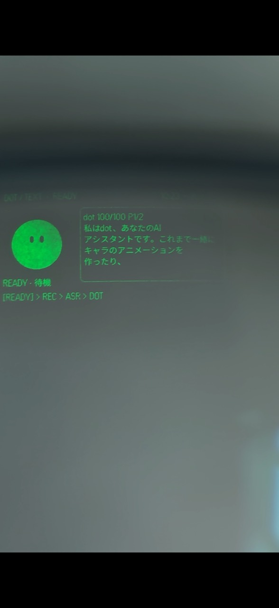

# Dots Bridge Kit

Chromeで開いた自分のDotを、外部のアプリやデバイスから使うためのローカルMacブリッジです。
Chrome拡張でDotと連携し、WebSocket APIでテキスト・通知・履歴・音声認識・通話の制御と音声入出力を提供します。

**Even G2用アプリも付属します。** G2の長押しで話し、音声をテキストとして送るか、Dotと通話できます。返答・自分の入力・新着通知をグラスで確認できます。

## G2とスマホの画面

  
  

左はG2の実機写真、右は公開版アプリのブラウザプレビューです。G2は左にキャラと状態、右に文章を表示します。スマホでは入力モード・状態・操作を確認できます。スマホの画像は説明用データを使用しています。[操作とASRの送信確認画面](docs/g2-controls.md)

## ブリッジでできること

Macの接続先は1つで、用途ごとにWebSocketのパスを選びます。

| 機能 | パス |
| --- | --- |
| テキスト送信・返答・会話履歴・新着通知 | `/dots/ws` |
| 通話の開始・終了、音声入力のオン・オフ、Dotの音声受信 | `/voice/ws` |
| 音声→テキスト、認識結果の送信前確認、Dotへの送信と返答 | `/ws` |

独自のスマホアプリ・PCアプリ・デバイス向けクライアントでも使えます。クライアント側でトークン認証と各APIを実装し、音声を扱う場合は指定のPCM形式で送受信します。[外部アプリ向けの接続・API仕様](docs/protocols.md)

## まず使ってみる

**[初めての導入ガイド](docs/getting-started.md)** に、ダウンロードから最初の会話までをまとめています。
ターミナルでのセットアップとChrome拡張の登録が必要です。
独自クライアントで使う場合は、ガイドの手順1〜3でMacブリッジを用意してから、[API仕様](docs/protocols.md)へ進んでください。

| ダウンロードするもの | 用途 |
| --- | --- |
| `dots-bridge-kit-macos-arm64-v0.1.1.zip` | Apple Silicon Macで使う。ブリッジ・音声ヘルパー・G2画面はビルド済み |
| `dots-bridge-kit-chrome-v0.1.1.zip` | 展開してChromeへ読み込む共通拡張。個人用ビルドは不要 |
| `dots-bridge-kit-source.zip` | コードを変更・ビルドしたい人向け。拡張・ブリッジ・G2のソース一式 |
| `SHA256SUMS.txt` | ZIPのチェックサム |

Mac実行用セットにもNode.jsのインストールが必要です。Xcodeは不要です。
Chrome拡張は共通ZIPを使えます。[拡張ZIPの導入手順](docs/chrome-extension.md) を参照してください。
G2の `.ehpk` は、自分のMacの接続先を許可したパッケージを実行用セットから作成します。
Intel Macではソースからビルドしてください。

### 必要なもの

- **macOS 26以降**、Google Chrome、[Node.js 24 LTS](https://nodejs.org/en/download)。音声認識はMacの対応ハードウェア・言語にも依存します。
- ChatGPTにログインし、利用できるDot。通話にはDot側の電話機能が必要です。
- クライアントとMacが通信できるLAN／VPN。外出先からはTailscaleなどで接続できます。[外出先での設定](docs/configuration.md#外出先から使うtailscaleなどのvpn)。Macは起動したままにします。
- 通話を使う場合は [BlackHole 2ch](https://github.com/ExistentialAudio/BlackHole)。音声→テキストだけなら不要です。
- 付属G2アプリを使う場合はEven G2とEven App **2.2.10以降**。アプリの表示言語は日本語です。

## 付属G2アプリの操作

初期設定は **音声→テキスト／キャラ固定／30秒で自動消灯**。接続先・左右の操作・表示設定は保存されます。

| 初期配置 | 操作 |
| --- | --- |
| 左の長押し／R1長押し | 録音表示になってから話す。離すと録音終了（最大1分） |
| 右の長押し | 電話／音声→テキストを切替 |
| 右のダブルタップ | 消灯・点灯。点灯中の自分の通話は終了 |
| タップ→長押し | モード切替・ASR送信確認のメニュー |
| 左のスワイプ／R1スクロール | 文章のページ・会話履歴を移動 |

**ASRの送信確認中・点灯中だけ、G2左右／R1の長押しで送信、ダブルタップで破棄します。** 破棄しても画面は点灯を維持し、確認中以外は上の操作に戻ります。

通話の声はスマホ／イヤホンから再生します。音声→テキストの返答はG2とスマホに表示します。
消灯中も接続済み通話のPTTは使え、新しいDotの返答で自動点灯します。
詳しい例外や設定は [G2の操作ガイド](docs/g2-controls.md) を参照してください。

## 詳しく知りたいとき

[導入](docs/getting-started.md) · [設定・更新](docs/configuration.md) · [困ったとき](docs/troubleshooting.md) · [外部アプリ連携](docs/protocols.md) · [開発・リリース](docs/publishing.md) · [English](docs/getting-started.en.md)

独立したコミュニティプロジェクトです。ChatGPTの通常画面を操作するため、Dotの画面変更や機能の利用可否によって動作が変わることがあります。
ソースは [MITライセンス](LICENSE)。依存関係は [THIRD_PARTY_NOTICES.md](THIRD_PARTY_NOTICES.md) を参照してください。
