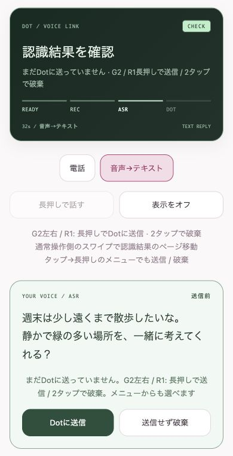

# G2の操作ガイド

接続が初めての場合は [導入ガイド](getting-started.md#5-最初の会話) から進めてください。

左にキャラと状態、右に文章、右上に時刻とおおよその電池残量を表示します。通話の声はスマホ／イヤホンから再生します。
[G2の実機写真とスマホ画面](../README.md#g2とスマホの画面) も参照できます。

## 点灯中

| 操作（初期配置） | 動作 |
| --- | --- |
| 左／R1長押し | PTT。RECになってから話し、離すと録音終了。最大1分。電話では必要なら通話開始から行う |
| 右長押し | 電話／音声→テキストを切替。自分の通話中は終了してから切替。電話へ切替だけでは発信しない |
| 右ダブルタップ | 消灯／点灯。自分の通話中で点灯している場合は通話終了を優先 |
| タップ→長押し | モード切替メニュー。ASRの送信確認中は送信／破棄も選べる |
| 左スワイプ／R1スクロール | 文章のページ移動。端から前後のメッセージへ進む |
| 左／R1の1タップ | 最新へ戻る。ASRの送信確認中は認識結果を維持 |

スマホの「操作・表示の設定」→「G2の左右の操作」で左右を入れ替えられます。
**通話終了だけは、左右設定にかかわらず物理的な右のダブルタップです。** スマホの「通話を終える」でも終了できます。
直前のタップに続く長押しはメニュー扱いなので、PTTはタップせず長押しします。接続・終了処理中はモード切替を待ちます。

## 消灯中

- 画面オフ側／R1のダブルタップで点灯します。通話終了より点灯が先です。
- 接続済みの自分の通話は、左右どちらの長押しでもPTTを使えます。つながっていない場合は反応しません。
- モード切替・メニュー・履歴移動は、点灯してから操作します。
- Dotの新しい文章・通話の発話で自動点灯します。新着文章では最新の1ページ目へ、手動点灯では読んでいた位置へ戻ります。

消灯は画面更新を減らす方式です。通話と接続は継続します。

## 音声→テキストの状態

| 常時表示 | 意味 |
| --- | --- |
| READY | 入力待ち |
| REC | 長押し中の録音 |
| ASR | 音声認識。送信確認がオンなら認識結果を確認する段階 |
| DOT | 送信して返答待ち |

「ASR結果を確認してからDotに送信する」をオンにすると、認識後に文章を表示して待ちます。**確認中・点灯中だけ、G2の左右どちらでも、またはR1で、長押しでそのまま送信、ダブルタップで破棄**できます。この間は通常のPTT・モード切替・消灯より送信／破棄を優先します。タップ→長押しのメニューとスマホのボタンからも選べます。

スマホの送信確認画面（公開版のブラウザプレビュー・説明用データ）。「送信前」の文章を確認し、スマホからも「Dotに送信」または「送信せず破棄」を選べます。

確認中以外の操作は上の表どおりです。設定がオフなら自動送信します。電話モードにはこの割り当てを適用しません。
DOTの返答待ち中も、スワイプやスマホの履歴一覧で過去ログを読めます。送信確認中はASR文章のページを移動します。

## 設定と履歴

スマホの「操作・表示の設定」で変更します。接続先と以下の設定はEven Appに保存され、次回起動時に復元します。

| 設定 | 初期値・選択肢 |
| --- | --- |
| 入力方法 | 音声→テキスト（電話にも切替可） |
| キャラを動かす | オフ。固定中も状態・文章は更新 |
| 左右の操作 | 右：画面オフ／左：通常操作 |
| 自動画面オフ | 30秒。無効／15秒／30秒／1分／2分／5分 |
| ASRの送信前確認 | オフ |
| 履歴の最大表示数 | 100件。10／30／50／100件 |

自動消灯は操作・新着からの待機時間です。録音・返答処理・送信確認・OSの通知表示中は消灯しません。

履歴には、ChromeのDots画面で読み込まれた「あなた」と「Dot」を会話順に表示します。ASR下書きは二重に追加しません。保持は直近100件で、表示数を減らしても保持分は消えません。
さらに古い文章は、ChromeのDotで上へスクロールして読み込みます。ChatGPTの全履歴を自動取得する機能ではありません。

## 通知・iPhoneの画面ロック

通知表示を理由にPTTや通話を終了しない処理と、復帰後の再接続処理を含みます。「接続を復旧しています」の間は入力を止め、復旧後に長押しをやり直します。
OSがEven Appを停止・終了した場合は継続できません。アプリを開き直して接続を確認します。終了確認が必要と出た場合は「通話を終える」で状態を確認してください。
