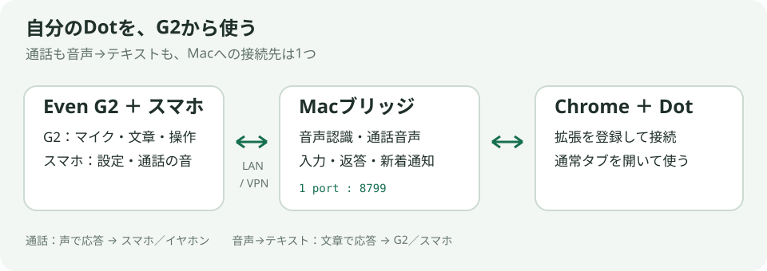
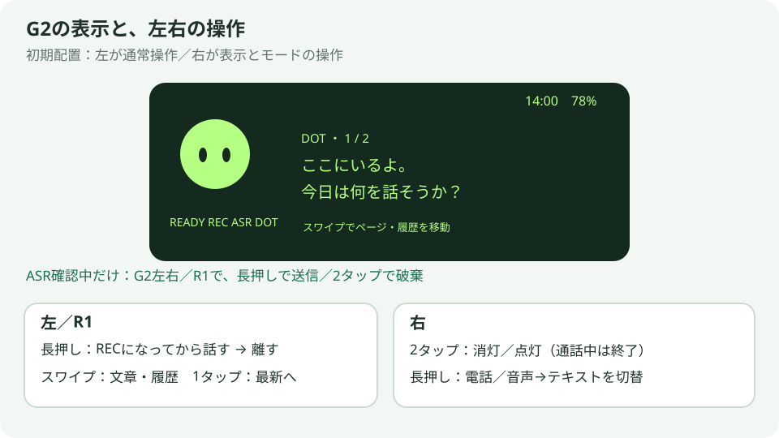

# Getting started

Dots Bridge Kit connects your existing Dot in a normal Chrome tab to Even G2 and your phone. The app UI is Japanese; this guide names the buttons shown on screen.

## Requirements and download

Use macOS 26 or newer with supported Apple speech-recognition hardware/language, Chrome, [Node.js 24 LTS](https://nodejs.org/en/download), Even G2 and Even App 2.2.10 or newer. Your account must have access to a Dot; calls also require its phone feature. Keep the Mac awake and on a LAN/VPN reachable from your phone.

Download `dots-bridge-kit-macos-arm64-v0.1.0.zip` for Apple Silicon. It includes compiled bridge/audio helpers and the G2 web app; Xcode is not needed. Node/npm dependencies are installed below. Intel Mac users should build the source ZIP with Xcode Command Line Tools following the [build guide](publishing.md#ソースからビルドする).

## Setup

1. Extract the ZIP to a permanent location. Open Terminal in that folder and run:

~~~sh
npm ci --omit=dev
npm run setup
~~~

Enter your Dot URL from Chrome and a Mac hostname/IP reachable from the phone, without a scheme or port. The token and extension identity are generated locally and preserved when you rerun setup.

2. Run `npm run chrome:install`. In Chrome, open `chrome://extensions`, enable Developer mode, and load **build/extension**. Keep your configured Dot open in a normal tab.
3. Run `npm run services:start`, reload the Dot tab, then run `npm run doctor`. Bridge/extension/call-control/ASR checks should be OK. On the phone, confirm that `http://YOUR_MAC_HOST:8799/` opens; replace YOUR_MAC_HOST with your own setup value.
4. Run `npm run pack:g2`. Upload `build/dots-phone-g2-0.2.25.ehpk` to your Even Hub project's **Private builds**. In Even App, use **Even Hub → Developer Mode → Me → Apps → Private builds → Install**, as described in the [official guide](https://hub.evenrealities.com/docs/test/private-testing). If the package ID is taken, repack with `npm run pack:g2 -- --package-id org.example.dotsphone`, replacing the example with your own unique ID.
5. Open Dots Phone G2 and allow its microphone/network permissions. Run `npm run token` in Terminal, paste your token into 「Macへの接続設定」 and tap 「保存して接続」. The endpoint is preconfigured. It should show 「テキスト 接続済み」.

The personal G2 package includes endpoint permissions but no token. It must be repacked after endpoint changes. Even Hub [requires exact origins](https://hub.evenrealities.com/docs/build/networking); wildcard hosts are unsupported.

## First conversation

- **Speech-to-text:** Select 「音声→テキスト」. Hold the left temple/R1, wait for REC, speak and release. REC → ASR → DOT → READY shows progress. Replies appear on the phone and glasses. Enable 「ASR結果を確認してからDotに送信する」 in settings to review first. While reviewing with the display awake, hold either G2 temple or R1 to send, or double tap to discard. The menu and phone buttons also work; other states retain their usual controls.
- **Call:** Install [BlackHole 2ch](https://github.com/ExistentialAudio/BlackHole), select it in Chrome's microphone settings, and reload Dot. Select 「電話」, tap 「通話音声をオン」 then 「通話を始める」. Grant macOS screen/system-audio recording permission if prompted; restart the bridge after changing it. Once connected, hold the left temple/R1 to speak. Audio plays on the phone/headphones. End with an awake right-temple double tap or 「通話を終える」.

By default, right hold switches input mode and right double tap turns the display off/on (or ends an awake owned call). Tap then hold opens the menu; left swipe browses history. Hold is limited to one minute. Incoming replies wake the display. Initial settings: speech-to-text, fixed character, 30-second display timeout. Connection and display settings persist.

For full controls and display-off behavior, see [G2 controls](g2-controls.md). Stop automatic startup with `npm run services:stop`; start again with `npm run services:start`. Do not run `npm start` and the background service together. Use [troubleshooting](troubleshooting.md) if any setup checkpoint fails.
