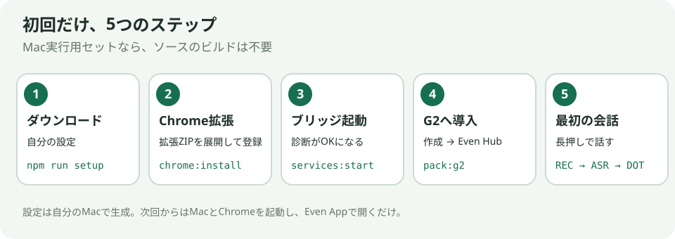
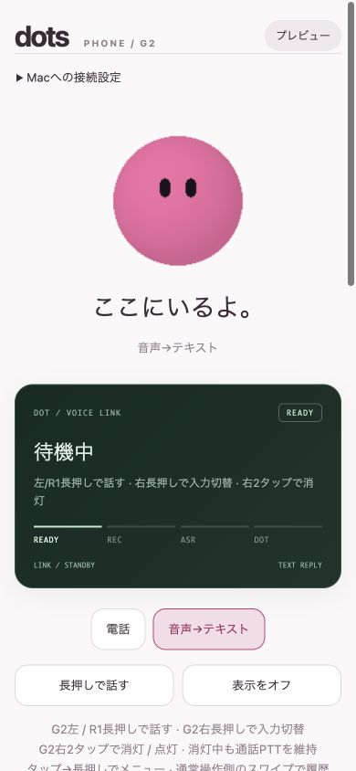

# 初めての導入

ここでは **Mac実行用セット** を使います。ソース版から始める場合は [ビルド手順](publishing.md#ソースからビルドする) を先に実行してください。
手順1〜3は共通のブリッジ導入、手順4〜5は付属G2アプリの導入・操作です。独自クライアントを使う場合は手順3まで済ませて、[外部アプリ連携](protocols.md)へ進みます。

## 1. ダウンロードと自分の設定

Apple Silicon Macでは `dots-bridge-kit-macos-arm64-v0.1.0.zip` をダウンロードして展開します。
[Node.js 24 LTS](https://nodejs.org/en/download) のmacOSインストーラーを導入してください。
展開したフォルダは使い続ける場所へ置きます。セットアップ後に移動すると、Chromeと自動起動の登録が古い場所を参照します。

ターミナルを開き、`cd ` に続けて展開したフォルダをドラッグし、Returnを押します。続けて実行します。

~~~sh
npm ci --omit=dev
npm run setup
~~~

質問されるのは次の2つです。

| 項目 | 入れる値 |
| --- | --- |
| あなたのDotのURL | Chromeで使いたいDotを開き、アドレス欄をコピー。`https://chatgpt.com/dots/home` または自分のDot IDを含むURL |
| Macのホスト名／IP | スマホから届くMacのホスト名、LANのIP、またはVPNの接続先。`ws://` やポートは付けない |

LANのIPはMacの「システム設定 → Wi-Fi → 接続先の詳細 → TCP/IP」で確認できます。
**外出先でも使う場合は、先にMacとスマホをTailscaleなどのVPNで接続し、MacのVPN IPを入力します。** VPNを使うのはMacとスマホで、G2はEven App経由でつながります。[Tailscaleの手順と接続確認](configuration.md#外出先から使うtailscaleなどのvpn)
セットアップに表示された `ws://YOUR_MAC_HOST:8799` がスマホの接続先です。以降の `YOUR_MAC_HOST` は自分が入力した値に置き換えます。
トークンは自動生成され、この段階では表示しません。

**できた目印：**「設定を保存しました」と表示され、`build/extension` が生成される。

## 2. Chrome拡張を登録

~~~sh
npm run chrome:install
~~~

Chromeで `chrome://extensions` を開き、右上の「デベロッパーモード」をオンにします。
「パッケージ化されていない拡張機能を読み込む」で、展開したフォルダの **build/extension** を選びます。
設定したDotの通常タブを開いておきます。フォルダの選び方は [Chrome公式手順](https://developer.chrome.com/docs/extensions/get-started/tutorial/hello-world) でも確認できます。

**できた目印：** 拡張一覧に「Dots Bridge Kit」が表示される。

## 3. Macブリッジを起動

~~~sh
npm run services:start
~~~

次回のMacログイン時にも起動します。起動後にChromeのDotタブを再読み込みし、確認します。

~~~sh
npm run doctor
~~~

**できた目印：**「統合ブリッジ」「Chrome拡張」「通話制御の接続」「音声認識」がOKになる。
診断は発言や通話開始を行いません。音声認識のモデルは初回に準備時間がかかる場合があります。

スマホから `http://YOUR_MAC_HOST:8799/` を開けることも確認してください。開けなければ、同じLAN／VPNへの接続とMacのファイアウォールの許可を確認します。
Macは起動・ネットワーク接続を維持し、ChromeのDotのウインドウを閉じたり最小化したりしないでください。

## 4. G2アプリを自分用に作って導入

~~~sh
npm run pack:g2
~~~

`build/dots-phone-g2-0.2.25.ehpk` ができます。Mac実行用セットでは再コンパイルしません。
G2は通信先をパッケージ内で許可する仕組みなので、Macの接続先ごとに作成します。トークンは含みません。[通信許可の公式説明](https://hub.evenrealities.com/docs/build/networking)

1. [Even Hub](https://hub.evenrealities.com) にEven Appと同じアカウントでログインし、自分のプロジェクトを開きます。
2. **Private builds** へ `.ehpk` をアップロードします。
3. スマホのEven Appで **Even Hub → Developer Mode → Me → Apps → Private builds** を開き、インストールします。画面名が異なる場合は [公式のPrivate Testing手順](https://hub.evenrealities.com/docs/test/private-testing) を参照してください。
4. **Dots Phone G2** を開き、G2マイク・ネットワークの許可を設定します。

「package_id taken」が出る場合は、自分だけのアプリIDにして作り直します。

~~~sh
npm run pack:g2 -- --package-id org.example.dotsphone
~~~

`org.example.dotsphone` は形式の例です。自分のプロジェクトで使用する、一意の小文字・ドット区切りのIDへ置き換えます。更新時も同じIDを指定します。

Macのターミナルで実行します。

~~~sh
npm run token
~~~

表示された自分のトークンを、スマホの「Macへの接続設定」に貼り付け、「保存して接続」を押します。
Macの接続先は作成したパッケージに設定済みです。公開場所や問い合わせにはトークンを貼らないでください。

**できた目印：** スマホが「テキスト 接続済み」になり、G2にキャラとREADYが表示される。

公開版のブラウザプレビューです。実際に接続したEven Appでは、右上の「プレビュー」が「テキスト 接続済み」になります。

## 5. 最初の会話

### まず音声→テキストを試す

1. スマホで「音声→テキスト」が選択されていることを確認します。
2. **G2左／R1を長押し**し、REC・録音中になってから話します。離すと録音が終わります。
3. **REC → ASR → DOT → READY** と進み、認識した文章とDotの返答がG2・スマホへ表示されます。

送る前に文章を確認したい場合は、「操作・表示の設定」の「ASR結果を確認してからDotに送信する」をオンにします。
認識結果を表示中は、G2の左右どちらでも、またはR1で、長押しで送信、ダブルタップで破棄できます。タップ→長押しのメニュー、スマホのボタンからも選べます。

### 通話を試す

1. Macに [BlackHole 2ch](https://github.com/ExistentialAudio/BlackHole) を導入します。Chromeで `chrome://settings/content/microphone` を開き、マイクを **BlackHole 2ch** にしてDotを再読み込みします。
2. スマホで「電話」を選び、「通話音声をオン」→「通話を始める」を押します。初回にMacの画面／システム音声収録の許可が出たら設定します。拒否済みなら「システム設定 → プライバシーとセキュリティ → 画面収録とシステムオーディオ録音」を確認し、音声ヘルパー／Nodeの許可を変更してブリッジを再起動します。
3. 「電話でつながっています」になったら、**G2左／R1を長押し**して話し、離します。Dotの声はスマホ／イヤホンから再生されます。
4. **点灯中のG2右をダブルタップ**、またはスマホの「通話を終える」で終了します。消灯中は先に点灯します。

電話モードへの切替だけでは発信しません。初回の音声設定が済めば、点灯中のG2左／R1長押しで通話開始から操作できます。

## 次から使う・停止する

MacとChromeのDotが開いていれば、Even AppからDots Phone G2を開くだけです。設定は保存されています。
左右の操作・自動消灯・履歴は [G2の操作ガイド](g2-controls.md)、接続先の変更や更新は [設定ガイド](configuration.md) にあります。

~~~sh
npm run services:stop
npm run services:start
~~~

上は再起動の手順です。`services:stop` だけなら停止とログイン時の自動起動解除を行います。手動で試す場合は常駐を止めて `npm start`（Ctrl+Cで終了）を使います。
接続できない場合は [困ったとき](troubleshooting.md) を参照してください。
